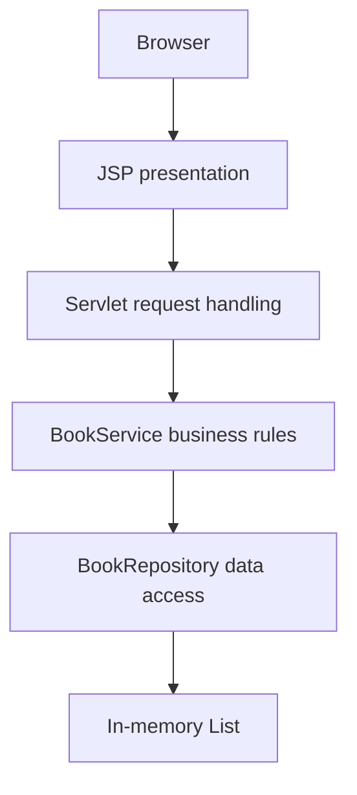

# BookShelf Architecture

BookShelf is a deliberately small Java web application built with JSP, Java Servlets, plain Java service classes, and an in-memory repository. It uses the Java EE 7 / Servlet 3.1 namespace (`javax.servlet`) and is packaged as a WAR for Apache Tomcat 9.

## Layered architecture

- **Presentation:** JSP pages render the home screen, book form, edit form, and book list.
- **Web:** Servlets handle HTTP requests, select the appropriate operation, and forward or redirect.
- **Business:** `BookService` normalizes input, validates required values, enforces ISBN uniqueness, and implements CRUD and search operations.
- **Data:** `BookRepository` owns the collection and provides synchronized access to it.
- **Lifecycle:** `ApplicationContextListener` creates one `BookService` when the web application starts and stores it in `ServletContext`.

## Request flows

### Add a book

1. The browser submits title, author, and ISBN to `POST /addBook`.
2. `AddBookServlet` retrieves the shared service from `ServletContext`.
3. `BookService` trims input, checks required fields, and rejects an ISBN already in the repository.
4. The repository stores the new `Book`.
5. The servlet redirects to `GET /viewBooks`. If validation fails, it forwards to the form with the error and submitted values.

### View and search

1. The browser requests `GET /viewBooks`, optionally with a `q` query parameter.
2. `ViewBooksServlet` asks the service for matching books.
3. The service searches title, author, and ISBN without exposing repository internals.
4. `viewBooks.jsp` renders the result list.

### Edit and delete

- `GET /editBook?isbn=...` loads a matching book into the edit form; `POST /editBook` validates and updates it.
- `POST /deleteBook` removes the book by ISBN and redirects to the list.

## Important design trade-off

The repository is intentionally in-memory. Data is shared by requests handled by the same running application instance, but it is not durable. Restarting or redeploying the application clears the collection. The demo is suitable for exploring servlet and service-layer design, not for storing important or long-lived data.

## Runtime and packaging

- Java 8
- Servlet API 3.1 (`javax.servlet`)
- Apache Tomcat 9
- Maven WAR packaging

Tomcat provides the Servlet API at runtime, so the Maven dependency is marked `provided`.
